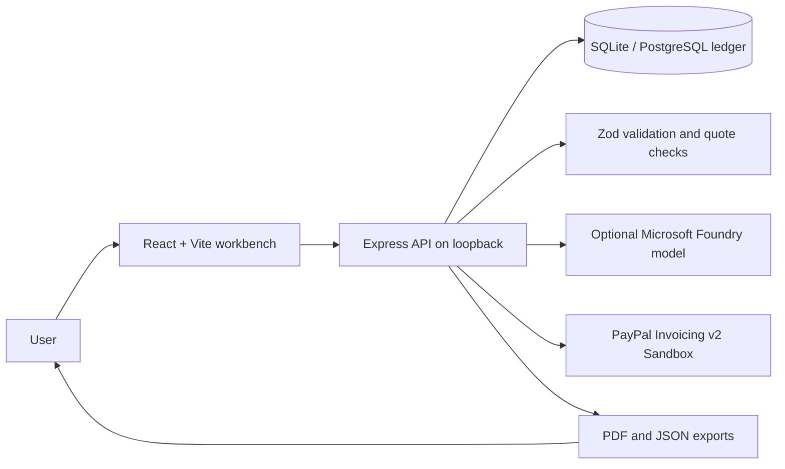

# Architecture

ClearDues is a TypeScript application. The browser handles the review workflow, the Express API owns provider credentials and validation, and SQLite locally or PostgreSQL on Vercel stores synthetic evidence plus the latest review/invoice snapshot.

## Request boundaries

- `server/index.ts` defines the HTTP routes, limits JSON request size, enables Helmet headers, rate-limits analysis, and binds to `127.0.0.1` by default.
- `server/domain.ts` owns input schemas, citation checks, human confirmation checks, and deterministic request IDs.
- `server/ai.ts` makes an optional server-side Microsoft Foundry resource Responses API request using the configured project endpoint's origin and resource API key. The model selects verbatim source excerpts and suggests gaps; model narrative is discarded. Deterministic code builds the summary and neutral editable starter.
- `server/paypal.ts` uses a fixed PayPal Sandbox host. OAuth credentials remain server-side; create/send operations require distinct user actions. Identical invoice payloads reuse an idempotency key.
- `server/ledger.ts` uses SQLite locally and PostgreSQL on Vercel to store evidence separately from the latest analysis/PayPal state record.

PayPal Sandbox draft creation and retrieval have been tested. The Foundry adapter still requires a configured project endpoint, resource key, and compatible deployment for a live test. Demo mode is clearly labeled and makes no external call.
