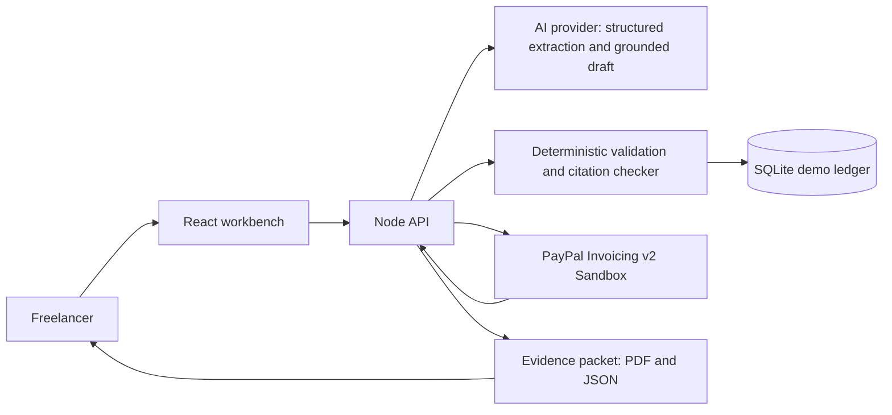

# Solution Plan: ClearDues

Accessed: 2026-11-09 | Deadline: 2026-11-13 1:30 AM GMT+5:30 | Build start: 2026-11-09 | Approx. 3.5 calendar days remain

## 1. Pitch (one line)

ClearDues helps Indian export-facing microbusinesses and freelancers turn late or disputed invoices into clear, evidence-backed next steps, with PayPal Sandbox invoices at the center.

## 2. Problem and target users

Primary users are solo freelancers and small service exporters in India who track overseas-client invoices in scattered files/messages and lack the time or leverage to follow up consistently. The RBI/C2FO/GAME/FISME 2025 Delayed Payments 3.0 summary reports ₹7.34 lakh crore in delayed MSME receivables as of March 2024, with micro units facing delays up to three times those of larger firms. Remote's 2025 vendor survey reports late payment is common for freelancers; its figures are vendor-published and will be described with that caveat.

The prototype is not legal, accounting, tax or collection advice. It will not claim a customer is in breach, threaten legal action, contact a debtor without human approval, or move real money.

## 3. Solution

A compact receivables workbench that:

- Presents a seeded sandbox case and supports adding an invoice/correspondence text record.
- Uses a configured AI model to select exact source excerpts and suggest facts to verify; deterministic code builds the summary and neutral starter.
- Validates amount, currency, due date, payment state and citations in deterministic code; highlights missing/contradictory data rather than guessing.
- Creates a PayPal Sandbox draft invoice from human-confirmed fields, with a separate explicit user action to send it.
- Refreshes invoice state from PayPal Sandbox and builds a neutral, evidence-linked chronology and downloadable PDF/JSON packet for internal review.
- Labels mock/demo and live sandbox data visibly. No real PayPal environment is supported.

## 4. Innovation statement

The twist is not another AI invoice writer or dunning bot. ClearDues connects a messy overdue-invoice story to a PayPal invoice state, then produces a traceable, human-reviewed evidence packet whose facts can be checked against quoted source snippets. The first-20-seconds demo starts with a late invoice, reveals the missing acceptance/payment evidence, selects exact excerpts for review, and presents a neutral editable starter without inventing a due date or legal claim.

## 5. Idea selection

| Idea          | Innovation | Impact | Tool depth | Feasibility | Demo-ability | Rubric fit | Differentiation | Total |
| ------------- | ---------- | ------ | ---------- | ----------- | ------------ | ---------- | --------------- | ----- |
| I01 ClearDues | 4/5        | 5/5    | 5/5        | 4/5         | 5/5          | 5/5        | 3/5             | 42/50 |

## 6. Competitor prediction

Likely adjacent entries include natural-language checkout, Channel3 shopping agents, spend/intent guards, merchant dashboards, payment reconciliation, subscription dunning, dispute automation, scope-creep billing, payment-linked schedulers and donation dashboards. ClearDues differs by centering a small exporter's evidence packet and human-reviewed invoice follow-up, not a generic assistant, merchant analytics view or autonomous transaction.

Closest products/projects: [CashMitra](https://www.cashmitra.co.in/) and [ZTS Invoice Collection Agent](https://ztsindia.com/service/invoice-collection-agent/) automate collection; [Payment Guardian](https://github.com/hgreco85/paypal-payment-guardian) and [ClearLedger AI](https://devpost.com/software/paypal-ai-reconciliation) focus on transaction reconciliation; [Transaction-Autopilot](https://github.com/Karthikjr48/transaction-autopilot) covers merchant recovery and disputes. ClearDues must keep evidence traceability and freelancer-sized workflow as the visible differentiators.

## 7. Rubric-to-feature map

| Criterion                    | Feature                                                                         | Demo moment                                                                   | Evidence                                                                                                                                |
| ---------------------------- | ------------------------------------------------------------------------------- | ----------------------------------------------------------------------------- | --------------------------------------------------------------------------------------------------------------------------------------- |
| Technological Implementation | PayPal Invoicing v2 Sandbox create/send/get plus AI exact-source selection      | Create and retrieve a Sandbox invoice; show selected quote against its source | Redacted request/response log, provider disclosure, integration tests                                                                   |
| Design                       | Receivables workbench with clear status, chronology, evidence and review action | Move from one invoice to its timeline and proposed next step                  | Responsive UI, keyboardable controls, empty/error/loading states                                                                        |
| Potential Impact             | Overdue/disputed invoice case for small service exporter                        | Show delayed invoice facts and missing evidence, then a practical next action | Cited research in docs and transparent caveats                                                                                          |
| Innovation/Idea              | Evidence-backed next-step packet                                                | Click a cited fact and reveal original source excerpt                         | Citation validation tests and generated packet                                                                                          |
| Presentation                 | Proof-first demo path                                                           | Show a real Sandbox invoice interaction and distinguish it from mock data     | Prepare a local video script and narration; public YouTube publication is waived by the user but remains an official submission blocker |

## 8. Mandatory resource usage

| Resource                         | How used                                                                                                                     | Where in code                          | How it is shown in demo                                                                                 |
| -------------------------------- | ---------------------------------------------------------------------------------------------------------------------------- | -------------------------------------- | ------------------------------------------------------------------------------------------------------- |
| PayPal Developer Platform (MUST) | Invoices v2 Sandbox: create draft, send only after confirmation, retrieve status                                             | `server/paypal/` client and API routes | Display Sandbox mode, PayPal invoice ID/status and action response; no live credentials or transactions |
| AI model/tool (MUST)             | Select exact source excerpts and suggest facts to verify; deterministic code builds the summary and neutral editable starter | `server/ai.ts`; `server/domain.ts`     | Show exact quotes, labeled AI suggestions, provider mode and human review step                          |
| Sponsor tools (MAY)              | None selected for MVP; no sponsor prize claim                                                                                | N/A                                    | Avoid shallow integration; revisit only if a tool materially improves the core workflow                 |

## 9. Architecture

## 10. Features and acceptance criteria

| Feature ID | Description                                                       | Priority | REQ IDs                            | Acceptance criteria (testable)                                                                                                                                   |
| ---------- | ----------------------------------------------------------------- | -------- | ---------------------------------- | ---------------------------------------------------------------------------------------------------------------------------------------------------------------- |
| F-001      | Seeded invoice workbench with visibly labeled synthetic/demo case | Must     | REQ-006, REQ-009, REQ-014          | Clean install opens one sample case; demo vs. Sandbox mode is always distinguishable.                                                                            |
| F-002      | Add correspondence text with size validation                      | Must     | REQ-009, REQ-011                   | Reject short/oversized input; preserve source IDs and exact excerpt text; no secrets or unnecessary personal data stored.                                        |
| F-003      | AI source-excerpt selection and gap suggestions                   | Must     | REQ-007                            | Validate output; retain only exact source quotes; build summary/starter deterministically; label suggested gaps for human review.                                |
| F-004      | Deterministic invoice policy checks                               | Must     | REQ-009, REQ-011                   | Reject invalid amount/currency/date; no AI-controlled payee, amount or send/capture operation.                                                                   |
| F-005      | PayPal Sandbox draft invoice create/get                           | Must     | REQ-006, REQ-009                   | With Sandbox credentials, create a draft and retrieve it by PayPal invoice ID; with no credentials, clearly labeled demo mode does not imply a real PayPal call. |
| F-006      | Human-confirmed PayPal invoice send                               | Must     | REQ-006, REQ-009, REQ-019          | Explicit confirmation is required before send; identical invoice fields reuse an idempotency key; failures remain visible.                                       |
| F-007      | Evidence timeline and packet export                               | Must     | REQ-009, REQ-014                   | Export PDF/JSON with source citations, timestamps, PayPal status and mock/sandbox labels; no legal conclusions.                                                  |
| F-008      | Unit/integration tests and CI                                     | Must     | REQ-009, REQ-013                   | Offline tests cover validation, citations, errors and human-approval boundaries; CI runs build, lint, tests and secret scan.                                     |
| F-009      | Submission docs and presentation materials                        | Must     | REQ-013, REQ-014, REQ-016, REQ-018 | README, tool disclosure, submission, PPTX/outline, HTML deck and video script/narration exist; public video remains a rules blocker.                             |

## 11. Tech stack and justification

- TypeScript, React and Vite for a quick, responsive demo UI.
- Node.js/Express API for PayPal credentials, AI calls, invoice actions and exports; credentials never reach the browser.
- SQLite for synthetic/demo case records and a local audit trail; external service state is fetched from PayPal when Sandbox mode is configured.
- OpenAI-compatible chat-completions API behind a provider adapter; endpoint/model/key are environment variables. No real AI provider key is confirmed, so `.env.example` will use placeholders and the UI will clearly expose demo mode until configured.
- PayPal REST Invoicing v2 directly, rather than a broad autonomous agent toolkit, to keep actions explicit and the Sandbox integration verifiable.

## 12. Security plan

- Sandbox-only host allowlist; refuse live PayPal URLs and live credentials.
- Never expose or log API keys, OAuth tokens, invoice recipient addresses or raw source text beyond the UI/request needed.
- Parse AI output as untrusted JSON; strict schema and numeric/date validation; no model-generated tool calls or direct payment actions.
- Human approval is required before creating a draft or sending an invoice; ClearDues does not send reminders or automate outreach.
- Use synthetic demo fixtures, input size/type limits, rate limits and request timeouts; sanitize rendered text and PDF content.
- `.env`, databases, generated evidence and build outputs ignored; `.env.example` uses placeholders only. Public repo must be scrubbed before any commit/push.

## 13. Milestones (back-planned from deadline)

| Milestone                   | Due (IST)              | Exit criteria                                                                                                                      |
| --------------------------- | ---------------------- | ---------------------------------------------------------------------------------------------------------------------------------- |
| Plan and walking skeleton   | Nov 9                  | App starts, mode is labeled, tests/lint/build scripts exist.                                                                       |
| PayPal + AI vertical slice  | Nov 10                 | Sandbox invoice path and AI excerpt-selection path function behind explicit confirmation; offline fallbacks labeled.               |
| Core UX and evidence export | Nov 10                 | Seeded case, cited timeline, neutral draft and PDF/JSON packet work.                                                               |
| QA and tests                | Nov 11                 | QA review complete; defects fixed; tests pass from clean checkout.                                                                 |
| Docs and submission package | Nov 11                 | README, tool disclosure, submission, slides/HTML deck and video script/narration complete.                                         |
| Final audit                 | By Nov 12 10:30 PM IST | Clean public repository, no secrets, final video/submission decision; reserve final 20% for QA, tests, docs, video and submission. |

## 14. Risks and mitigations

| Risk                                                  | Mitigation                                                                                                                                         |
| ----------------------------------------------------- | -------------------------------------------------------------------------------------------------------------------------------------------------- |
| No runtime AI key/model account confirmed             | Use provider adapter; keep fully labeled demo mode; request user-local key before claiming real-model demo.                                        |
| Sandbox invoice permissions/configuration unavailable | Provide an explicit diagnostic/setup checklist and stable seeded demo; never mislabel mock responses as PayPal.                                    |
| Invoice/correspondence includes sensitive client data | Synthetic fixtures; minimize retention; warn against uploading personal or confidential material.                                                  |
| LLM invents dates, terms or liability                 | Evidence citations required, deterministic consistency checks, missing values shown, human review.                                                 |
| Deadline too short for two entries and public upload  | Only Project 1 approved; complete its gates before considering additional work.                                                                    |
| Rules require public YouTube video but user waives it | Produce script/narration as requested; mark final Devpost submission blocked/noncompliant until user changes waiver or uploads a qualifying video. |

## 15. Demo storyline (shot list)

1. Open a seeded overdue export invoice; clearly show Sandbox/demo mode.
2. Add a short client email excerpt and run AI source-excerpt selection (or verify the explicit no-model demo state).
3. Open a cited date/amount/acceptance fact; show one missing fact being flagged rather than invented.
4. Review and edit the neutral starter; ClearDues does not send this message.
5. Create a PayPal Sandbox draft and, only after separate confirmation, send the invoice; show the returned ID/status.
6. Refresh the case and export the evidence packet; close with the factual next step, not a legal claim.

## 16. Submission checklist

- [ ] Public GitHub repository with OSS LICENSE visible.
- [ ] README setup/run/test steps work from a clean clone.
- [ ] PayPal Sandbox and AI service use clearly disclosed.
- [ ] Functional hosted demo or complete local run instructions, test access and safe synthetic data.
- [ ] Text description, tools disclosure and Devpost fields completed.
- [ ] Public YouTube demo under three minutes (waived by user; do not publish; submission remains blocked/noncompliant unless the user changes the waiver).
- [ ] No secrets in working tree or Git history; secret scan passes.
- [ ] QA report passes; tests green; docs, Google-Slides-ready outline, HTML deck, video script/narration present.

## 17. Prizes targeted

- Primary: 1st/2nd/3rd Place; Best Use of PayPal + AI; Most Impactful.
- One project may only win one Grand Prize OR one Honorable Mention, plus at most one Sponsor Prize. No sponsor tool prize is claimed for MVP.

HANDOFF -> Builder
Project: 01-cleardues
Done: Idea I01 selected by user; scope and acceptance criteria defined.
Open items / assumptions: Runtime AI provider/key; PayPal Invoicing Sandbox credentials; exact per-entry Devpost form fields; YouTube submission video waived by user.
Risks: Tight deadline and possible missing external credentials. Clearly label mock data and do not claim PayPal/AI calls were made when unavailable.
Files to read first: docs/hackathon/BRIEF.md; docs/hackathon/IDEA_RESEARCH.md; projects/01-cleardues/docs/PLAN.md
